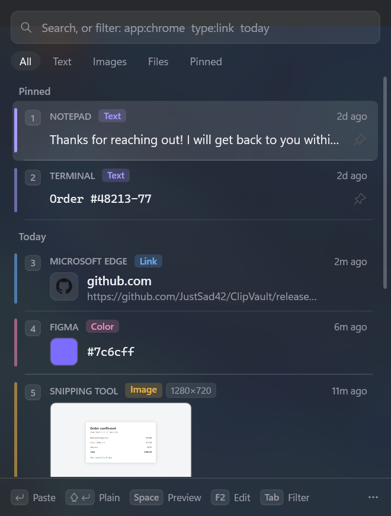
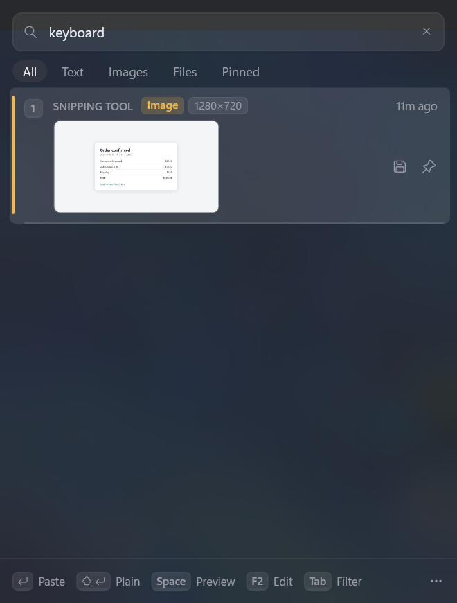

# ClipVault

A fast, good-looking clipboard manager for Windows 11. Press **Ctrl+Shift+V** anywhere to open your clipboard history right at your text cursor, pick an item, and it's pasted into the app you were using.

<p align="center"></p>

## Features

- **Searchable history** of text, images and files, saved between restarts
- **Typo-tolerant search** with highlighted matches, plus filters: `app:chrome`, `type:link`, `type:qr`, `today`, `date:week`
- **Search inside images**: text in screenshots is read with Windows' built-in OCR (offline)
- **QR codes** in copied images are detected; open the link or copy the text
- **Smart cards** for links (site icon), colors (swatch, copy as HEX/RGB/HSL), emails, phone numbers, code and files (thumbnail, size, date)
- **Quick paste** with 1–9, **pins**, filter tabs and a thumbnail grid for images
- **Paste options**: formatted or plain, UPPERCASE / lowercase / Title Case / trimmed / single line, and apps that always get plain text
- **Edit before pasting**: text editor, plus crop, rotate and blur for images
- **Removes link tracking** (`utm_source`, `fbclid`, …) as you copy
- **Undo** deletes, drag items out into other apps, save items to files
- Frosted-glass Windows 11 look, follows your theme and accent color, compact mode, resizable popup
- **Updates itself** from GitHub releases (verified with SHA-256)

## How it works

| | |
|---|---|
|  |  |
| **1. Press Ctrl+Shift+V.** Your history opens at the text cursor, newest first, with pins on top. Press 1–9 or Enter to paste. | **2. Type to search.** Matches include text read from screenshots: "keyboard" finds the order receipt image. |

The ⋯ button (bottom right) has compact mode, settings and the data folder. The clips in these screenshots are made up.

## Install

1. Install the [.NET 10 Desktop Runtime](https://dotnet.microsoft.com/download/dotnet/10.0) (x64) if you don't have it.
2. Download `ClipVault.exe` from the [latest release](https://github.com/JustSad42/ClipVault/releases/latest) and put it in a folder you can write to, e.g. `%LOCALAPPDATA%\Programs\ClipVault`.
3. Run it. Open Settings from the ⋯ button to change the shortcut or start ClipVault with Windows.

Your history is stored locally in `%APPDATA%\ClipVault` and never leaves your PC. (The only network requests are update checks to GitHub and, if enabled, website icons fetched directly from the sites you copied links from.)

## Keyboard

| Key | Action |
|---|---|
| Ctrl+Shift+V | Open / close |
| Enter / Shift+Enter / Ctrl+Enter | Paste / paste as plain text / copy only |
| 1–9 (or Alt+1–9) | Quick paste |
| Space | Full preview |
| Tab / Shift+Tab | Switch filter tab |
| F2 | Edit (text or image) |
| Ctrl+P | Pin / unpin |
| Ctrl+O | Open link / show file |
| Ctrl+S | Save to file |
| Del, then Ctrl+Z | Delete, undo |

## Building and releasing

Requires the .NET 10 SDK.

```powershell
dotnet run                       # try it locally
.\release.ps1 1.1.0 "What changed"
```

`release.ps1` bumps the version, commits, tags and pushes. The GitHub Actions workflow then builds `ClipVault.exe`, publishes it as a release, and every installed copy picks it up within a few hours.
